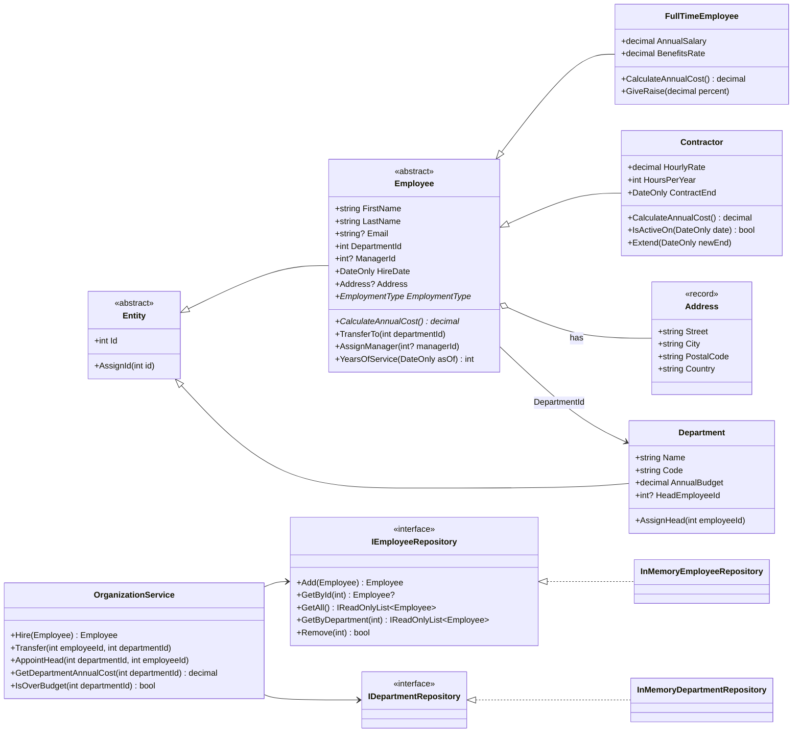

# Day 2: Domain model and SOLID

Library: `src/EmployeeManagement.Domain`

## Class diagram

## OOP concepts used

| Concept | Where |
|---|---|
| Encapsulation | All setters are `private`. State only changes through methods that check rules, such as `GiveRaise`, `AssignManager` and `TransferTo`. |
| Inheritance | `FullTimeEmployee` and `Contractor` both derive from `Employee`. |
| Polymorphism | `CalculateAnnualCost()` is `abstract` in `Employee`. Code that totals a department's cost does not need to know the employee kind. |
| Abstract class vs interface | `Employee` is an abstract class because the subclasses share state (names, hire date) and behaviour. `IEmployeeRepository` is an interface because it is a pure contract that very different storage types can implement. |
| Records | `Address` is a `record`, so it is immutable and compared by value. |
| Structs | `SalaryStats` in the console app is a `readonly struct`, a small value that is copied by value. |
| Access modifiers | `Guard` is `internal` (only visible inside the library). Constructors of `Employee` are `protected` (only subclasses can call them). Subclasses are `sealed`. |
| Composition | `Employee` *has an* `Address`. `OrganizationService` *has* repositories rather than inheriting from them. |

## SOLID in this library

- **S, single responsibility.** Entities enforce their own rules. Repositories only store and fetch. `OrganizationService` coordinates rules that span several entities, such as "the head of a department must work in it".
- **O, open/closed.** A new employee kind, such as an intern, is a new subclass with its own `CalculateAnnualCost()`. `OrganizationService.GetDepartmentAnnualCost` does not change.
- **L, Liskov substitution.** Any `Employee` subclass can be used wherever an `Employee` is expected, and `CalculateAnnualCost()` always returns a non-negative cost.
- **I, interface segregation.** There are separate `IEmployeeRepository` and `IDepartmentRepository` interfaces instead of one large `IRepository` that does everything.
- **D, dependency inversion.** `OrganizationService` depends on the repository *interfaces*. The in-memory implementations can be replaced by EF Core in Week 2 without touching the service.

### Composition vs inheritance

Inheritance is used only where there is a real "is-a" relationship (`Contractor` *is an* `Employee`). Behaviour that is not about identity, such as storage or address, is composed. That keeps the inheritance tree shallow, so a change to the base class does not ripple into unrelated features.
