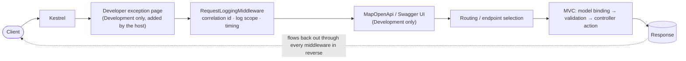

# Day 7: Dependency injection, middleware, configuration and logging

## Request pipeline



**Why order matters:** each middleware wraps everything registered *after* it. `RequestLoggingMiddleware` is registered first, so its timing and status code cover the whole request, including errors thrown further in. If it were registered after routing or authentication, requests those steps short-circuit (404s, 401s) would never be logged. On Day 8 the exception handler goes right after it, so the logger sees the final mapped status code rather than the raw exception.

## Service lifetimes

All registrations are in [`DependencyInjection.cs`](../../src/EmployeeManagement.Api/DependencyInjection.cs).

| Lifetime | Service | Why this lifetime |
|---|---|---|
| **Singleton**, one per app | `TimeProvider`, in-memory `IEmployeeRepository` and `IDepartmentRepository` | The clock is stateless and thread-safe. The in-memory store *is* the app's shared state, so it must outlive requests. |
| **Scoped**, one per request | `ICorrelationContext`, `OrganizationService` | The correlation id belongs to one request. `OrganizationService` will depend on a `DbContext` (scoped) from Day 9. |
| **Transient**, new each time | `IEmployeeFactory` | Stateless and cheap, with nothing worth sharing. |

`ServiceLifetimeTests` proves each behaviour against the real registrations.

### Captive dependency

A captive dependency is a longer-lived service holding a shorter-lived one. For example, a singleton that takes a scoped `DbContext` in its constructor keeps that one instance forever, shared across threads. Middleware classes are created once, so `RequestLoggingMiddleware` takes `ICorrelationContext` as an `InvokeAsync` parameter (resolved per request), never in its constructor. `ValidateScopes`, on automatically in Development, throws when a scoped service is resolved from the root provider. `ServiceLifetimeTests.ScopedService_ResolvedFromRoot_IsRejected` covers this.

### Why use DI?

- Classes declare what they need and do not build it themselves, so dependencies are explicit.
- Implementations can be swapped: the in-memory store becomes EF Core on Day 9 without touching controllers.
- Tests can inject fakes, such as the `FakeTimeProvider` used by `EmployeeFactoryTests`.
- Lifetimes and disposal are managed in one place.

## Custom middleware: `RequestLoggingMiddleware`

- It reads `X-Correlation-Id` from the request and only reuses it if it is safe (letters, digits and `-`, at most 64 characters). Otherwise it generates a new id. The id is echoed in the response header and stored in the scoped `ICorrelationContext`.
- It opens a logging **scope** (`CorrelationId:{CorrelationId}`), so every log line in the request carries that property, including lines written by controllers.
- It logs `HTTP {Method} {Path} responded {StatusCode} in {ElapsedMs} ms` at Information, at **Warning** above `SlowRequestThresholdMs`, and at **Error** for 5xx responses or exceptions (it records 500 and rethrows).
- It **never logs** query strings, headers or bodies. They can contain emails, tokens or other personal data. The test `InvokeAsync_LogsMethodPathAndStatus_ButNotQueryString` checks this.

Development output (single-line simple formatter, scopes on):

```text
info: ...RequestLoggingMiddleware[0] => RequestPath:/api/employees/1 ... => CorrelationId:demo-123 HTTP GET /api/employees/1 responded 200 in 89.3 ms
info: ...EmployeesController[0] => RequestPath:/api/employees ... => CorrelationId:hire-42 => ...Create Hired employee 11 into department 1
info: ...RequestLoggingMiddleware[0] => RequestPath:/api/employees ... => CorrelationId:hire-42 HTTP POST /api/employees responded 201 in 38.9 ms
```

Production output (JSON formatter, so log tools can query fields such as `StatusCode` and `CorrelationId`):

```json
{"LogLevel":"Information","Category":"EmployeeManagement.Api.Middleware.RequestLoggingMiddleware",
 "Message":"HTTP GET /api/employees/2 responded 200 in 71.2 ms",
 "State":{"Method":"GET","Path":"/api/employees/2","StatusCode":200,"ElapsedMs":71.2474}, "Scopes":[ ..., {"CorrelationId":"59cd01a2..."}]}
```

## Configuration and environments

| Setting | `appsettings.json` (all environments) | `appsettings.Development.json` (overrides) |
|---|---|---|
| Console log format | `json` | `simple`, single line |
| `EmployeeManagement` log level | Information | Debug |
| `RequestLogging:SlowRequestThresholdMs` | 500 | 200 |
| `Hiring:MaxDaysInFuture` | 90 | (inherited) |

Precedence, lowest to highest: `appsettings.json` → `appsettings.{Environment}.json` → user secrets (Development) → environment variables → command line. For example, `RequestLogging__SlowRequestThresholdMs=50` as an environment variable overrides both files.

**Options pattern.** `RequestLoggingOptions` and `HiringOptions` are bound with `AddOptions<T>().Bind(...).ValidateDataAnnotations().ValidateOnStart()`, so an invalid value (for example a threshold of `0`) stops the app at startup.

## Tests added

- `RequestLoggingMiddlewareTests` (7): correlation id generated, reused or rejected; status logged without the query string; slow-request warning with a `FakeTimeProvider`; error and rethrow on exceptions. Uses `FakeLogger`.
- `EmployeeFactoryTests` (3): the hire-date limit relative to an injected clock.
- `ServiceLifetimeTests` (5): singleton, scoped and transient behaviour, scope validation and options binding.
