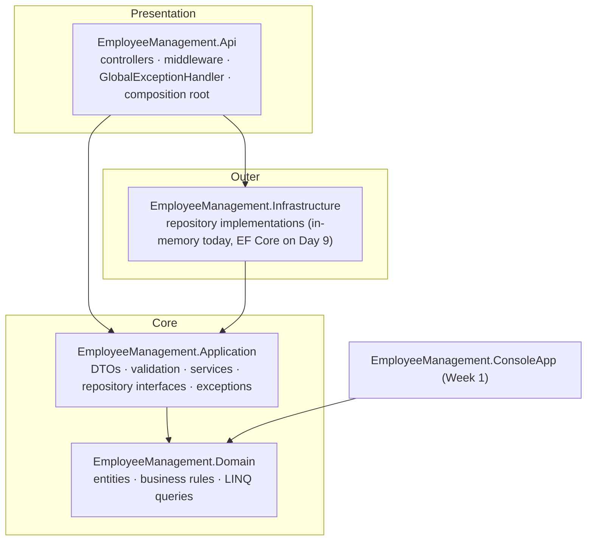

# Day 8: Layered architecture, validation and error handling

## Projects and dependencies



Arrows point at what a project references. Dependencies point **inwards**. Domain references nothing, and Application only knows the interfaces it declares (`IEmployeeRepository`, `IDepartmentRepository`, `IUnitOfWork`). Infrastructure implements those interfaces, so Application never references a storage technology. The Api project is the **composition root**: `AddEmployeeManagement` wires every layer together.

## Responsibilities

| Layer | Does | Never does |
|---|---|---|
| Controller | Route, bind, pick the *success* status code (`201` + `Location`, `204`, `200`) | Business rules, data access, try/catch |
| Service (`EmployeeService`, `DepartmentService`) | Rules that need data (department exists, manager exists, no deleting a manager with reports), calls domain methods, **validates everything before changing anything**, saves once | HTTP types or status codes, SQL |
| Domain entity | Its own invariants (`GiveRaise` limits, `AssignManager` not self) | Data access |
| Repository | Load and store aggregates | Business decisions |

### Repository vs service

A repository is a collection-like abstraction over storage ("get employee 5", "does department 2 have staff?"). A service is a use case ("hire an employee"). It coordinates several repositories and domain objects, then commits through the unit of work.

### DTO vs entity

Entities (`FullTimeEmployee`) protect invariants with private setters and behaviour methods, and they include internal details. DTOs (`CreateEmployeeRequest`, `EmployeeResponse`) are the public contract: flat, serialisable, and versioned with the API. Keeping them separate means the database schema and the API contract can change independently, and clients cannot over-post fields such as `Id` or `AnnualCost`. Mapping is manual, in `EmployeeMappings` and `DepartmentMappings`.

## Validation in two stages

1. **Shape**, using DataAnnotations and `IValidatableObject` on the DTO. `[ApiController]` rejects invalid bodies before the action runs.
2. **Rules that need data**, in the service. Problems are collected in `ValidationErrors`, so the client gets *every* problem at once (for example both `DepartmentId` and `ManagerId`), and then `RequestValidationException` is thrown.

Both stages produce the same `ValidationProblemDetails` shape.

## Central exception handling

`GlobalExceptionHandler : IExceptionHandler`, registered with `UseExceptionHandler()`:

| Exception | Status | Example |
|---|---|---|
| `RequestValidationException` | 400, `errors` dictionary | unknown department or manager, hire date too far ahead |
| `DomainException` / `ArgumentException` | 400 | raise for a contractor |
| `NotFoundException` | 404 | `GET /api/employees/999` |
| `ConflictException` | 409 | duplicate department code, deleting a manager |
| anything else | 500, **no detail** | unexpected bug (logged at Error, message never returned) |

`UseStatusCodePages()` turns empty 4xx responses, such as an unknown route, into `ProblemDetails` too. `AddProblemDetails` adds a `correlationId` to every error, matching the `X-Correlation-Id` header and the log scope from Day 7.

Example responses (captured from the running API):

```json
// POST /api/employees with departmentId 99 and managerId 77
{"type":"https://tools.ietf.org/html/rfc9110#section-15.5.1","title":"One or more validation errors occurred.","status":400,
 "errors":{"DepartmentId":["Department 99 does not exist."],"ManagerId":["Employee 77 does not exist."]},
 "traceId":"00-f0b7…-00","correlationId":"f3b13a0c…"}

// DELETE /api/employees/1
{"type":"https://tools.ietf.org/html/rfc9110#section-15.5.10","title":"The request conflicts with the current state.","status":409,
 "detail":"Asha Raman still manages other employees. Reassign them first.","traceId":"00-2da9…-00","correlationId":"12f95c33…"}

// GET /api/nope
{"type":"https://tools.ietf.org/html/rfc9110#section-15.5.5","title":"Not Found","status":404,"traceId":"00-3531…-00","correlationId":"b41f6a28…"}
```

### Middleware vs filters

| | Middleware | MVC filters |
|---|---|---|
| Runs for | every request, including static files, unknown routes and Swagger | only requests that reach an MVC action |
| Knows about | `HttpContext` only | the action, its arguments, `ModelState` and the result |
| Use for | cross-cutting HTTP concerns: logging, correlation ids, exception handling, auth | action-specific concerns: validation shape, caching a result, auditing an action |

Exception handling is done in middleware (`UseExceptionHandler`) rather than an exception filter, because a filter would miss exceptions thrown outside MVC.

## Tests added

- `tests/EmployeeManagement.Application.Tests` (new project, using hand-written fakes for repositories and the unit of work):
  - `EmployeeServiceTests`: valid create saves once; unknown department and manager reports both fields and saves nothing; 404; a self-manager update is rejected *before* any change; a raise for a contractor; deleting a manager returns a conflict.
  - `DepartmentServiceTests`: duplicate name or code; keeping its own name on update; deleting a department with staff; the over-budget cost summary.
  - Moved from Api.Tests: DTO validation, mapping and factory tests.
- `GlobalExceptionHandlerTests`: each exception type → status code, field errors kept, 500 never leaks the message.

## Known limitations

- The in-memory store's lock protects the collections but not edits to an entity shared by two concurrent requests. EF Core (Day 9) gives each request its own tracked copy.
